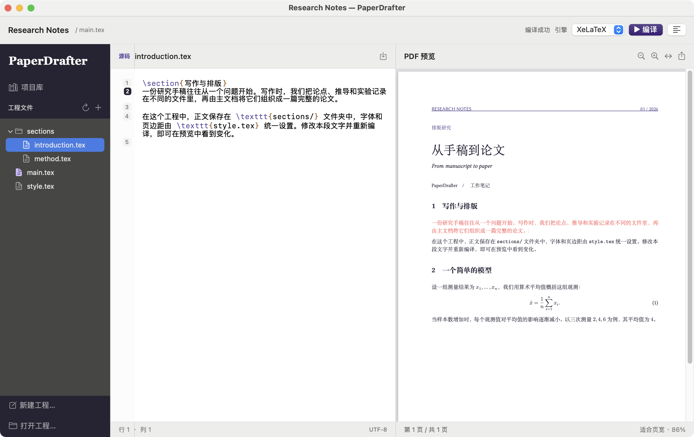

# PaperDrafter

PaperDrafter 是一款用 Swift 编写的 macOS 本地 LaTeX 编辑器。你可以在同一窗口浏览工程文件、编辑中英文稿件并查看 PDF。



## 功能

- **工程管理**：从 ACM、IEEE 或通用模板新建工程，打开本地文件夹，或导入 Overleaf 源码 ZIP。最近使用的工程可从项目库打开。
- **编译与预览**：支持 Tectonic、pdfLaTeX、XeLaTeX 和 LuaLaTeX，可查看编译日志并导出 PDF。
- **双向定位**：双击 PDF 中的文字或图片，光标会跳到相应的源码。点击源码行号可在预览中标红对应内容，再点一次恢复。
- **选句润色**：配置 DeepSeek Harness 后，选中一句中文或英文即可查看润色建议。若本机装有配套写作素材库，还可参考与章节和写作用途匹配的例句。

## 使用

1. 在 macOS 13 或更高版本上安装 Xcode Command Line Tools。编译论文还需安装 Tectonic（`brew install tectonic`），或安装含 `latexmk` 的 MacTeX 以使用另外三种引擎。
2. 克隆仓库，在仓库目录中构建并启动应用：

   ```sh
   ./build.sh
   open PaperDrafter.app
   ```

3. 从「文件」菜单新建或打开工程。编辑后按 **⌘↩** 编译，右侧会显示 PDF。界面语言可在「PaperDrafter → 界面语言 / Language」中切换。
